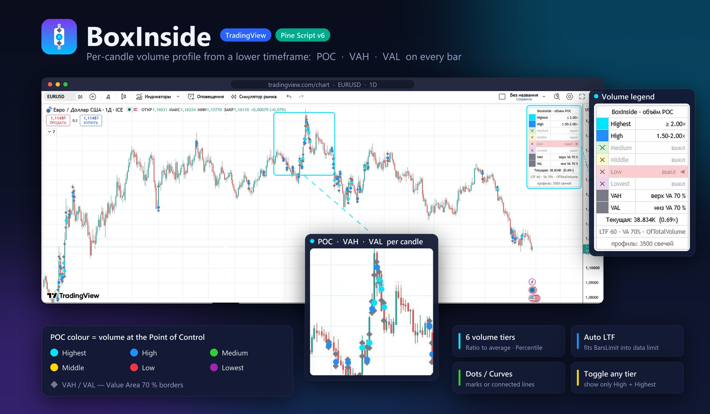

<div align="center">

#  BoxInside — Per-Candle Volume Profile for TradingView

**See where the volume sat inside every single bar.**
A TradingView port of the MetaTrader 4 indicator *BoxInside*: each candle gets its own volume profile
built from lower-timeframe data, with the **POC** drawn as a dot coloured by its volume and the
**VAH / VAL** value-area borders as diamonds.

[](https://www.tradingview.com/pine-script-docs/)
[](https://www.tradingview.com/)
[](#-differences-from-the-mt4-version)
[](#-lower-timeframe--history-depth)
[](#-whats-new-in-v4)
[](LICENSE)

🇷🇺 [Русская версия](README.ru.md)



</div>

---

## 📋 Table of Contents

- [✨ Features](#-features)
- [🎯 What It Shows](#-what-it-shows)
- [⚙️ How It Works](#️-how-it-works)
- [🚀 Installation](#-installation)
- [🎛️ Settings](#️-settings)
- [🧭 Lower Timeframe & History Depth](#-lower-timeframe--history-depth)
- [📊 Legend Table](#-legend-table)
- [💡 Recommended Presets](#-recommended-presets)
- [🔄 Differences from the MT4 Version](#-differences-from-the-mt4-version)
- [🆕 What's New in v4](#-whats-new-in-v4)
- [🗂️ Project Structure](#️-project-structure)
- [🚧 Known Limitations](#-known-limitations)
- [🙏 Credits](#-credits)
- [📄 License](#-license)

---

## ✨ Features

|                                |                                                                                       |
| ------------------------------ | ------------------------------------------------------------------------------------- |
| 🕯️ **Profile per candle**      | Every bar gets its own volume profile — not one profile for a whole session or range   |
| 🎯 **POC · VAH · VAL**         | Point of Control and both Value Area borders marked right on the candle               |
| 🎨 **6 volume tiers**          | The POC dot is coloured by how heavy its volume is: Lowest → Highest                  |
| 📐 **Two tiering methods**     | *Ratio to average* with your own thresholds, or *Percentile* — six equal groups       |
| 📏 **Two Value Area methods**  | *OfTotalVolume* (classic, may be asymmetric) or *OfPocND* (normal distribution, ±z·σ) |
| 🧭 **Auto lower timeframe**    | Picks the finest LTF whose data covers all *BarsLimit* candles                        |
| 🔀 **Dots / Curves**           | Marks on each candle, or lines connecting POC, VAH and VAL across candles             |
| 👁️ **Toggle any tier**         | Hide whole tiers — e.g. keep only **High** + **Highest** to see the heavy bars        |
| 📊 **Legend table**            | Colour scale, current bar's tier, LTF in use and data coverage warning                |
| 🧮 **TPO fallback**            | No volume on the symbol? Switches to time-at-price (Market Profile) automatically      |
| 🔁 **No repainting of history**| Closed candles keep their marks; only the forming bar updates                         |
| 🔝 **Drawn above candles**     | Marks sit on top of the bars; adjustable transparency keeps candles visible           |

> The indicator's settings and table are in Russian, as in the original version. This README gives
> every setting with its on-screen name.

---

## 🎯 What It Shows

| Mark                      | Meaning                                                                                  |
| ------------------------- | ---------------------------------------------------------------------------------------- |
| 🔵 **Coloured dot**       | **POC** (Point of Control) — the price with the largest volume inside the candle         |
| ◆ **Grey diamond above**  | **VAH** (Value Area High) — upper border of the value area                                |
| ◆ **Grey diamond below**  | **VAL** (Value Area Low) — lower border of the value area                                 |

The POC colour shows the volume at the POC compared with previous candles (default *Ratio to average*):

| Colour | Tier        | POC volume vs. average |
| :----: | ----------- | :--------------------: |
|   🩵   | **Highest** |       ≥ 2.00×          |
|   🔵   | **High**    |     1.50 – 2.00×       |
|   🟢   | **Medium**  |     1.00 – 1.50×       |
|   🟡   | **Middle**  |     0.75 – 1.00×       |
|   🔴   | **Low**     |     0.50 – 0.75×       |
|   🟣   | **Lowest**  |       < 0.50×          |

> ⚠️ As in the original, the position and colour of the marks on the **current, still-forming
> candle** become final only close to its close. Closed candles are never redrawn.

---

## ⚙️ How It Works

```text
   Chart candle (e.g. D1)                       Lower-timeframe candles (e.g. H1)
 ┌─────────────────────────┐   request.security_lower_tf   ┌──────────────────────┐
 │ High ─────────────────  │ ◄──────────────────────────── │ high · low · volume  │
 │                         │                               │ of every LTF bar     │
 │ Low  ─────────────────  │                               └──────────────────────┘
 └───────────┬─────────────┘
             ▼
   Split High–Low into N rows ──► spread each LTF bar's volume evenly over the rows it touched
             ▼
   POC = row with the most volume ──► Value Area grown to ValueArea % ──► VAH / VAL
             ▼
   POC volume vs. last Lookback candles ──► one of 6 tiers ──► colour of the dot
```

| Step | What happens                                                                                                |
| :--: | ----------------------------------------------------------------------------------------------------------- |
|  1   | For each of the last **BarsLimit** candles the script receives the high, low and volume of every LTF bar inside it |
|  2   | The candle's High–Low range is split into **Rows** price rows (or rows of a fixed **Ticks per row**)        |
|  3   | Each LTF bar adds its volume, split evenly, to all rows between its low and high (TPO mode adds 1 instead)  |
|  4   | **POC** — the row with the largest volume; on a tie the row closest to the candle's centre wins             |
|  5   | **Value Area** — *OfTotalVolume*: grows from the POC towards the heavier neighbouring row until *ValueArea %* of the volume is inside. *OfPocND*: VAH/VAL = POC ± z·σ, where σ is the volume-weighted deviation from the POC and z matches *ValueArea %* (≈ 1.04 for 70 %) |
|  6   | **Tier** — POC volume divided by the average POC volume of the last *Lookback* candles (or its percentile rank) |

The POC volume of each candle is also shown in the **Data Window** as *POC volume*.

---

## 🚀 Installation

1. Open [TradingView](https://www.tradingview.com/chart/) → **Pine Editor** at the bottom of the chart.
2. Create a new indicator, delete the template code and paste the contents of
   [`BoxInside_v4.pine`](BoxInside_v4.pine).
3. **Save** → **Add to chart**.
4. Working timeframes: **M5 to MN**, as in MT4. On M1–M4 choose *LTF = Вручную* (manual) and a
   seconds timeframe such as `15S`.

> 💡 Free TradingView plans work. Higher plans only raise the lower-timeframe data limit
> (see [History Depth](#-lower-timeframe--history-depth)).

---

## 🎛️ Settings

### 📈 Profile — «Профиль»

| Setting                          | Default             | Description                                                                                       |
| -------------------------------- | ------------------- | ------------------------------------------------------------------------------------------------- |
| **ValueArea, %**                 | 70                  | Value Area size. 68–70 % is usual; larger values move VAH/VAL further from the POC                |
| **ValueAreaType**                | OfTotalVolume       | *OfTotalVolume* — classic, may be asymmetric. *OfPocND* — symmetric ±z·σ around the POC, clipped to High/Low |
| **VolumesType**                  | Volume (Tick/Real)  | *Volume* — the data vendor's volume (tick volume on Forex/CFD, real on stocks, futures, crypto). *Without (TPO)* — each LTF bar counts as 1 |
| **Rows (строк профиля)**         | 50                  | Price rows per candle (5–500). More rows — a sharper POC but slower. Small candles are capped by their number of ticks |
| **Ticks per row (0 = по Rows)**  | 0                   | Fixed row height in ticks, like the point-based mode of MT4. When > 0, *Rows* is ignored. At most 1000 rows per candle |
| **LTF** + timeframe              | Auto по BarsLimit   | Lower timeframe the profile is built from — see [modes](#-lower-timeframe--history-depth)         |
| **BarsLimit**                    | 1000                | How many of the latest candles get a profile (10–20 000)                                          |
| **Лимит младших баров тарифа**   | 100 000             | LTF bars TradingView gives your plan: 100 000 (Basic…Premium), 125 000 (Expert), 200 000 (Ultimate) |

### 🖌️ Display — «Отображение»

| Setting                              | Default      | Description                                                                 |
| ------------------------------------ | ------------ | --------------------------------------------------------------------------- |
| **DrawingMode**                      | Dots         | *Dots* — POC dot and VAH/VAL diamonds on every candle. *Curves* — lines connecting the levels |
| **☑ VAHColor / ☑ VALColor**          | on, grey     | The checkbox shows or hides the level, the swatch sets its colour           |
| **Размер точки POC**                 | 4            | POC dot size (1–10)                                                          |
| **Размер меток VAH/VAL (Dots)**      | Tiny         | Diamond size in Dots mode: Tiny / Small / Normal / Large                     |
| **Толщина линий VAH/VAL (Curves)**   | 1            | VAH/VAL line width in Curves mode (1–10)                                     |
| **Цвет кривой POC (Curves)**         | purple       | POC line colour in Curves mode                                               |
| **Красить кривую POC по объёму**     | off          | In Curves mode, colour the POC line and dots by volume tier                  |
| **Прозрачность меток, %**            | 0            | Marks are drawn above candles; 30–50 % lets the candles show through         |

### 🎨 POC Colours — «Цвета POC по объёму»

Six colours from the smallest POC volume to the largest (names as in MT4). The **checkbox left of
each colour** shows or hides the candles of that tier.

| Setting                | Default         | Tier                         |
| ---------------------- | --------------- | ---------------------------- |
| ☑ **LowestBoxColor**   | on, purple      | minimum volume               |
| ☑ **LowBoxColor**      | on, red         | low                          |
| ☑ **MiddleBoxColor**   | on, gold        | below / around average       |
| ☑ **MediumBoxColor**   | on, green       | around / above average       |
| ☑ **HighBoxColor**     | on, blue        | high                         |
| ☑ **HighestBoxColor**  | on, cyan        | maximum                      |
| **Скрывать и VAH/VAL у выключенных градаций** | on | On — a hidden tier hides all its marks (POC, VAH, VAL). Off — only the POC dot is hidden |

> Hiding a tier only affects drawing: averages and tiers are still computed over all candles, so the
> colours of the visible marks don't change. In Curves mode the lines break where candles are hidden.

### 📐 Volume Tiers — «Градация объёма POC»

| Setting        | Default                         | Description                                                                                      |
| -------------- | ------------------------------- | ------------------------------------------------------------------------------------------------ |
| **Метод**      | Ratio to average                | *Ratio to average* — POC volume ÷ average POC volume of *Lookback* candles, compared with the thresholds. *Percentile* — percentile rank among the last *Lookback* candles, six groups of ≈ 16.7 % |
| **Lookback**   | 100                             | How many previous candles take part in the comparison (5–2000)                                  |
| **Пороги**     | 0.50 / 0.75 / 1.00 / 1.50 / 2.00 | *Ratio to average* only, in multiples of the average. **Must be ascending**                     |

### 📊 Table — «Таблица»

| Setting                 | Default    | Options                                          |
| ----------------------- | ---------- | ------------------------------------------------ |
| **Показывать таблицу**  | on         | Show / hide the legend table                     |
| **Позиция**             | Top Right  | Top Right · Top Left · Bottom Right · Bottom Left |
| **Размер текста**       | Small      | Tiny · Small · Normal                            |

---

## 🧭 Lower Timeframe & History Depth

**LTF modes:**

| Mode                                | How the lower timeframe is chosen                                                                     |
| ----------------------------------- | ----------------------------------------------------------------------------------------------------- |
| **Auto по BarsLimit** *(default)*   | The finest of M1, M2, M3, M5, M10, M15, M30, H1, H2, H4, D1 whose data covers all *BarsLimit* candles. With a small BarsLimit it matches MT4 (M1 for H1); with a large one it gets coarser (H1 + BarsLimit 5000 → M5) |
| **Auto как MT4**                    | The fixed table below                                                                                 |
| **Вручную** *(manual)*              | The timeframe selected on the right                                                                   |

| Chart timeframe | Auto как MT4 |
| --------------- | :----------: |
| M5 … H1         |      M1      |
| H2 … H4         |      M5      |
| up to D1        |     M30      |
| W1              |      H4      |
| MN              |      D1      |

**Why depth is limited.** A profile needs the LTF bars inside each candle, and TradingView gives a
script **at most 100 000 lower-timeframe bars** (125 000 on Expert, 200 000 on Ultimate). How many
chart candles that covers depends on the timeframe ratio:

| Chart + LTF  | LTF bars per candle | Candles covered (100 000) |
| ------------ | :-----------------: | :-----------------------: |
| M15 + M1     |         15          |         ≈ 6 600           |
| H1 + M1      |         60          |       **≈ 1 660**         |
| H4 + M5      |         48          |         ≈ 2 080           |
| D1 + M30     |         48          |       **≈ 2 080**         |
| H1 + M5      |         12          |         ≈ 8 300           |

*Auto по BarsLimit* makes the LTF coarser automatically so the data reaches every requested candle
(H1 + BarsLimit 5000 → M5, D1 + BarsLimit 3000 → H1). The last line of the legend table reports the
coverage and turns **orange** when data runs out: `⚠ профиль: N из M свечей — выберите LTF крупнее`.

> The chart itself loads 5 000 – 40 000 candles depending on your TradingView plan; BarsLimit can't
> show more than the chart has.

---

## 📊 Legend Table

The table (top right by default) shows the current state of the indicator:

- 🎨 six tier rows with colour swatch, name and range; the tier of the **current candle** is highlighted
  and marked `◄`;
- ◆ **VAH** and **VAL** rows with their colours and the Value Area size;
- ✕ tiers and levels switched off by checkboxes appear faded with **✕** and `выкл` (off);
- 📈 **Текущая** — POC volume of the last candle and its ratio to the average (or its percentile);
- 🧭 LTF in use, ValueArea % and the Value Area method;
- ✅ coverage — how many candles got a profile (orange if fewer than BarsLimit).

> TradingView tables can't be clicked, so tiers are switched with checkboxes in the settings and the
> table mirrors their state.

---

## 💡 Recommended Presets

| Goal                                         | Settings                                                          |
| -------------------------------------------- | ----------------------------------------------------------------- |
| 🖥️ Same as MT4 (daily, Forex)                | D1, LTF = Auto как MT4 (M30), ValueArea 70, OfTotalVolume, Dots    |
| ⏱️ Intraday trading                          | M15–H1, LTF = Auto по BarsLimit, Rows 30–50, BarsLimit 500–1500    |
| 📜 Long history on H1 / D1                   | BarsLimit 5000+, LTF = Auto по BarsLimit (coarsens the LTF itself) |
| 〰️ Watch POC / Value Area drift over time    | DrawingMode = Curves                                              |
| ⚖️ Even colouring regardless of volatility   | Метод = Percentile, Lookback 100–200                              |
| 🔥 Only the heavy bars                        | Keep ☑ High and ☑ Highest, untick the other four tiers            |
| 🚫 Symbol without volume                      | VolumesType = Without (TPO)                                       |

---

## 🔄 Differences from the MT4 Version

- 🔒 The original `box-inside-bar.ex4` is compiled and encrypted (MT4 build 600+), so the algorithm was
  rebuilt from the author's description and screenshots, not from source code. The original defaults
  and the POC colour rule were never published — here they are configurable, and the default colours
  are taken from the screenshots.
- 📦 Instead of separate *Tick* and *Real* modes, TradingView's single volume series is used (tick
  volume on Forex/CFD, real volume elsewhere).
- ➕ Added: *Rows* / *Ticks per row*, manual LTF, tiering method and thresholds, per-tier visibility,
  the legend table.
- 📉 History depth is bounded by TradingView's lower-timeframe data limit ([details](#-lower-timeframe--history-depth)).

---

## 🆕 What's New in v4

| # | Change                                                  | How                                                                                          |
| - | ------------------------------------------------------- | -------------------------------------------------------------------------------------------- |
| 1 | POC dots and VAH/VAL diamonds were drawn under candles  | Declared with `behind_chart = false` — marks are always on top. Use *Прозрачность меток* if they cover the bars |
| 2 | Marks jumped to the front only on table hover           | Now they are on top by default. To send them back temporarily: indicator menu (⋯) → **Visual order → Send to back** |
| 3 | Nothing was drawn beyond ~2000 candles                  | New **Auto по BarsLimit** LTF mode and a coverage line in the table                          |

---

## 🗂️ Project Structure

```text
indicator_boxinside_tw/
├── BoxInside_v4.pine     # the indicator — paste into TradingView Pine Editor
├── docs/
│   ├── logo.png          # README logo
│   └── mockup.jpg        # README mockup (EUR/USD, 1D)
├── README.md             # this file
├── README.ru.md          # Russian version
└── LICENSE
```

---

## 🚧 Known Limitations

| Area                     | Finding                                                                                             |
| ------------------------ | --------------------------------------------------------------------------------------------------- |
| 🕯️ Forming candle        | Marks on the live bar move until it closes — use closed candles for decisions                      |
| 📉 History depth         | Limited by 100 000 / 125 000 / 200 000 LTF bars per plan; a coarser LTF goes deeper but is rougher |
| 📊 Forex volume          | Tick volume differs between feeds (OANDA, FXCM, brokers) — tiers vary slightly between EUR/USD symbols |
| ⏱️ M1–M4 charts          | Need a seconds LTF chosen manually; the automatic modes start at M1                                 |
| 🖱️ No mouse interaction  | Pine Script has no mouse events, so the table is display-only and the drawing order can't follow the cursor |

---

## 🙏 Credits

- Original MetaTrader 4 indicator **BoxInside** (`box-inside-bar.ex4`) — **Evgeny Shevtsov**.
- TradingView port (Pine Script v6) — **LPCMS**.

---

## 📄 License

Distributed under the **Apache License 2.0** — see [LICENSE](LICENSE).

This project is not affiliated with TradingView or MetaQuotes. It is an analysis tool, not financial
advice.

<div align="center">

Made with ❤️ by **LPCMS** · Ukraine 🇺🇦

</div>
